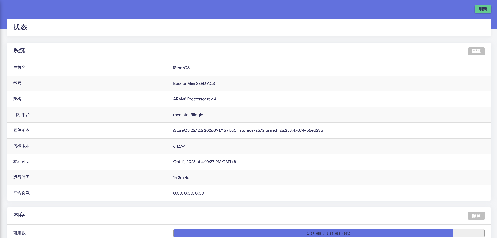

# luci-app-ac3-lan-ports

**BeeconMini SEED AC3 的 WAN / LAN 网口协商速度查看应用。**

在 iStoreOS 的 LuCI 管理页面中查看 WAN 和 8 个 RJ45 LAN 口的连接状态和实际协商速度，每 5 秒自动刷新。页面入口：**状态 → 网口协商速度**。

仓库名为 `luci-app-ac3-lan-ports`，安装包名称为 `luci-app-lan-ports`。

## 功能

- 一页查看 WAN 和 8 个 LAN 口的连接状态和协商速度。
- WAN 使用物理接口 eth0 的实时状态，同时显示全双工 / 半双工。
- 按机壳标签 LAN1–LAN8 显示端口。
- 显示外部物理网口的协商速度，而不是内部 CPU 链路的固定速率。
- 未连接的端口显示 `—`；读取失败时显示错误，避免误用历史数据。
- 无需安装 Docker，也无需运行原厂交换机管理服务。
- 不修改 VLAN、网络配置、网口速率或双工设置。

## 已验证环境

| 项目 | 配置 |
| --- | --- |
| 设备 | BeeconMini SEED AC3 |
| 固件 | iStoreOS 25.12.5 2026091716 |
| LuCI | istoreos-25.12 branch 26.253.47074~55ed23b |
| 处理器架构 | ARMv8 Processor rev 4 |
| 软件包架构 | aarch64_cortex-a53 |
| 目标平台 | mediatek/filogic |
| 内核 | 6.12.94 |
| 交换机驱动 | kmod-switch-rtl8373 6.12.94-r1 |
| 软件包 | luci-app-lan-ports 1.1.0-r0 |

只适用于上述硬件及已验证的驱动版本。安装脚本检查机型和驱动，软件包依赖固定的交换机驱动版本。



## 端口顺序

机壳标签与交换机芯片编号的方向相反，页面已按下表映射：

| 机壳标签 / 页面端口 | 芯片端口编号 |
| --- | --- |
| LAN1 | 7 |
| LAN2 | 6 |
| LAN3 | 5 |
| LAN4 | 4 |
| LAN5 | 3 |
| LAN6 | 2 |
| LAN7 | 1 |
| LAN8 | 0 |

实机核对时，物理标签为 LAN6、LAN7、LAN8 的三个端口均显示 **2.5 Gbps**。这是当时的连接状态，实际协商速度取决于对端设备和网线。

## 安装与卸载

### 安装

从 [GitHub Releases](https://github.com/M48A1/luci-app-ac3-lan-ports/releases/tag/v1.1.0) 下载编译好的安装包：

- [luci-app-lan-ports-1.1.0-r0.apk](https://github.com/M48A1/luci-app-ac3-lan-ports/releases/download/v1.1.0/luci-app-lan-ports-1.1.0-r0.apk)
- [SHA256SUMS.txt](https://github.com/M48A1/luci-app-ac3-lan-ports/releases/download/v1.1.0/SHA256SUMS.txt)

准备 `luci-app-lan-ports-1.1.0-r0.apk`，将文件上传至路由器 `/tmp`，在路由器终端执行：

```sh
apk add --allow-untrusted /tmp/luci-app-lan-ports-1.1.0-r0.apk
```

这是 OpenWrt/iStoreOS 软件包，不是 Android 应用。自定义包未签名，`--allow-untrusted` 只用于本次安装。

重新登录管理页面后打开 **状态 → 网口协商速度**。安装、升级和卸载会重启 RPC 服务，当前网页会话需要重新登录。

安装包声明以下依赖；缺少依赖时，需要路由器的软件源能够提供对应版本：

```text
luci-base
rpcd-mod-file
kmod-mdio-netlink
kmod-switch-rtl8373=6.12.94-r1
```

### 卸载

可在软件包管理器搜索 `luci-app-lan-ports` 卸载，或执行：

```sh
apk del luci-app-lan-ports
```

## 构建

在 Linux 环境准备 Go 1.22 或更新版本，以及包含 `mkpkg` 命令的完整 apk-tools v3。部分路由器固件精简了 `mkpkg`，可以用官方 Alpine 的完整静态构建工具临时打包。

克隆源码后进入项目目录：

```sh
git clone https://github.com/M48A1/luci-app-ac3-lan-ports.git
cd luci-app-ac3-lan-ports
sudo ./build.sh
```

如果默认 `apk` 不包含 `mkpkg`，指定完整打包工具路径：

```sh
# 指定其他打包工具路径：
sudo APK_BUILDER=/path/to/apk.static ./build.sh
```

构建脚本交叉编译静态 ARM64 程序，然后生成 `luci-app-lan-ports-1.1.0-r0.apk`。脚本需要 root 权限，为打包文件设置 root 所有权；它不安装应用。

## 目录

| 文件 | 用途 |
| --- | --- |
| `main.go` | 读取 LAN 交换机及 WAN 物理接口状态并输出 JSON |
| `files/www/luci-static/resources/view/status/lan_ports.js` | LuCI 页面及自动刷新 |
| `files/usr/share/luci/menu.d/` | 页面菜单 |
| `files/usr/share/rpcd/acl.d/` | 只允许执行读取程序的权限 |
| `scripts/` | 机型检查和安装、卸载后刷新菜单 |
| `build.sh` | 编译和生成 APK |

## 实现说明

WAN 状态来自 `/sys/class/net/eth0/` 的 `carrier`、`speed` 和 `duplex`，显示物理网口的链路速率，不显示 PPPoE 虚拟接口速度。

程序使用 [mdio-tools 的 MDIO netlink 协议](https://github.com/wkz/mdio-tools)，读取 RTL8373 的链接状态寄存器 `0x63e8` 和速率寄存器 `0x63f0`。

读取过程会向 MDIO 管理寄存器写入目标地址及读取命令 `0x1b`，不发送 ASIC 配置写入命令。一个事务内锁定 MDIO 总线，并在结束前恢复地址和数据暂存寄存器，配合现有驱动的后台检测。硬件访问出错或忙碌时返回错误。

本项目以实际运行的交换机驱动和设备读取结果核对寄存器及速度编码，尚未验证其他机型、其他驱动版本或所有协商速率。

## 版本更新

- **1.1.0**：新增 WAN 口连接状态、协商速度和双工模式，页面标题改为「网口协商速度」。LAN 端口顺序保持一致。
- **1.0.1**：按物理标签调整 LAN1–LAN8 的显示顺序。

## 验证

已在上述设备完成安装、卸载、重新安装和 1.0.0 → 1.0.1 升级；已验证页面显示 8 个端口并自动刷新。设备的物理 LAN6、LAN7、LAN8 显示 2.5 Gbps，其余端口未连接。

1.1.0 已验证 WAN 与 8 个 LAN 口同时显示、自动刷新及 1.0.1 → 1.1.0 升级。实机 WAN 协商为 1 Gbps、全双工。LAN 的双工模式未读取，页面显示 `—`。

## 常见问题

**为什么不能直接查看 `eth1` 的速度？**

在已验证设备上，`eth1` 是连接交换机的内部链路，其固定速率不能代表 8 个外部 LAN 口分别协商出的速度。本应用读取交换机的端口状态。

**安装后没有看到菜单？**

重新登录管理页面并刷新浏览器。可用 `apk info -e luci-app-lan-ports` 检查软件包是否已安装。

**页面提示读取失败？**

在路由器终端执行 `/usr/libexec/lan-port-status` 查看错误信息，并确认机型、内核及交换机驱动与已验证环境相符。此版本尚未适配其他机型或驱动版本。

## 许可证

[MIT](LICENSE)
